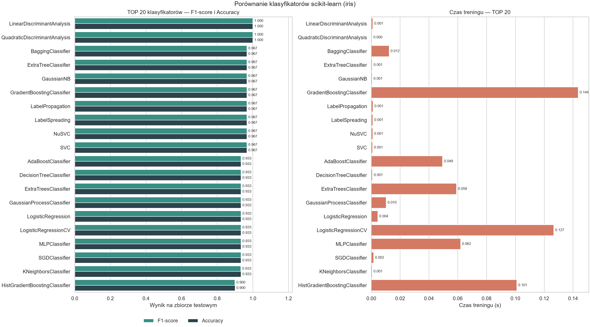
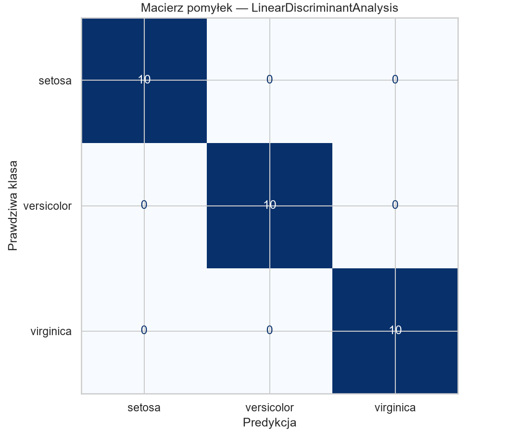

# Porównanie klasyfikatorów scikit-learn na zbiorze Iris

Skrypt `compare_classifiers.py` pobiera wszystkie klasyfikatory z `sklearn.utils.all_estimators`, trenuje te, które da się utworzyć domyślnymi argumentami, i zestawia je na jednym podziale oraz w walidacji krzyżowej.

Dla każdego działającego modelu liczone są accuracy, balanced accuracy, precision, recall i F1 (średnia ważona) oraz ROC AUC one-vs-rest, gdy model zwraca prawdopodobieństwa. Dodatkowo 5-krotna walidacja krzyżowa zapisuje średnią i odchylenie standardowe accuracy. Meta-estymatory bez wymaganego estymatora oraz modele, które nie przyjmują zeskalowanych cech, trafiają do `skipped_classifiers.log`. W tym przebiegu oceniono **31** klasyfikatorów, a **13** pominięto.

## Zbiór danych Iris

Użyty jest `sklearn.datasets.load_iris`: 150 próbek, 4 cechy ciągłe (długość i szerokość działki kielicha oraz płatka, w cm) i 3 klasy po 50 próbek — setosa, versicolor, virginica.

Podział to `train_test_split` 80/20 ze `stratify=y` i `random_state=42` (120 próbek treningowych, 30 testowych). `StandardScaler` jest uczony tylko na zbiorze treningowym. Walidacja krzyżowa działa na tym samym, już zeskalowanym zbiorze treningowym: `StratifiedKFold(n_splits=5, shuffle=True, random_state=42)` oraz `cross_val_score` ze scoringiem `accuracy`. Metryki F1 i accuracy w tabeli pochodzą z jednorazowego zbioru testowego.

## Ranking



Najwyższy wynik na zbiorze testowym mają **LinearDiscriminantAnalysis** i **QuadraticDiscriminantAnalysis** (F1 i accuracy równe 1.0000). Macierz pomyłek lidera rankingu, LDA, nie zawiera żadnej pomyłki: po 10 próbek setosy, versicolor i virginiki trafia na przekątną.



## TOP 15

Kolejność jest malejąca według F1-score, a przy remisie według accuracy. Czasy treningu są w sekundach. Puste ROC AUC oznacza model bez `predict_proba` sumującego się do 1 (zostaje wtedy `decision_function`, którego ten przebieg nie wlicza do AUC).

| Klasyfikator | F1 | Accuracy | ROC AUC | CV accuracy | CV std | Czas treningu (s) |
| --- | ---: | ---: | ---: | ---: | ---: | ---: |
| LinearDiscriminantAnalysis | 1.0000 | 1.0000 | 1.0000 | 0.9750 | 0.0333 | 0.0011 |
| QuadraticDiscriminantAnalysis | 1.0000 | 1.0000 | 1.0000 | 0.9667 | 0.0312 | 0.0005 |
| BaggingClassifier | 0.9666 | 0.9667 | 0.9983 | 0.9417 | 0.0204 | 0.0124 |
| ExtraTreeClassifier | 0.9666 | 0.9667 | 0.9750 | 0.9417 | 0.0333 | 0.0006 |
| GaussianNB | 0.9666 | 0.9667 | 0.9900 | 0.9500 | 0.0167 | 0.0006 |
| GradientBoostingClassifier | 0.9666 | 0.9667 | 0.9967 | 0.9417 | 0.0204 | 0.1436 |
| LabelPropagation | 0.9666 | 0.9667 | 0.9967 | 0.9583 | 0.0264 | 0.0012 |
| LabelSpreading | 0.9666 | 0.9667 | 1.0000 | 0.9583 | 0.0264 | 0.0011 |
| NuSVC | 0.9666 | 0.9667 | — | 0.9667 | 0.0167 | 0.0010 |
| SVC | 0.9666 | 0.9667 | — | 0.9667 | 0.0167 | 0.0008 |
| AdaBoostClassifier | 0.9333 | 0.9333 | 0.9750 | 0.9333 | 0.0204 | 0.0495 |
| DecisionTreeClassifier | 0.9333 | 0.9333 | 0.9500 | 0.9500 | 0.0167 | 0.0008 |
| ExtraTreesClassifier | 0.9333 | 0.9333 | 0.9967 | 0.9500 | 0.0312 | 0.0592 |
| GaussianProcessClassifier | 0.9333 | 0.9333 | 0.9900 | 0.9750 | 0.0204 | 0.0103 |
| LogisticRegression | 0.9333 | 0.9333 | 0.9967 | 0.9583 | 0.0264 | 0.0045 |

Pełna tabela jest w `classifiers_comparison.csv`.

## Wnioski

Wiele modeli ląduje na tym samym F1, bo Iris jest małym i łatwym zbiorem. Setosa jest liniowo oddzielona od pozostałych klas, a versicolor i virginica nachodzą na siebie tylko częściowo. Cztery cechy liczbowe i zbalansowane klasy (po 50 próbek) sprawiają, że domyślne ustawienia większości klasyfikatorów wystarczają. Zbiór testowy ma tylko 30 próbek, więc jedna pomyłka przesuwa accuracy o około 0.033. Stąd skupiska wyników: osiem modeli ma F1 0.9666, a kolejna grupa 0.9333. Idealne 1.0000 u LDA i QDA na teście nie oznacza bezbłędności w każdym podziale — walidacja na 120 próbkach treningowych daje im odpowiednio 0.9750 ± 0.0333 i 0.9667 ± 0.0312.

Najszybsze modele o wysokiej accuracy to metody dyskryminacyjne i liniowe. Wśród wyników testowych co najmniej 0.96 najkrócej trenuje się QuadraticDiscriminantAnalysis (0.0005 s), potem GaussianNB i ExtraTreeClassifier (0.0006 s) oraz SVC (0.0008 s). LinearDiscriminantAnalysis, lider rankingu, mieści się w 0.0011 s. GradientBoostingClassifier ma to samo F1 co GaussianNB (0.9666), ale trening trwa 0.1436 s, czyli ponad dwieście razy dłużej.

Najstabilniejsze według walidacji krzyżowej są modele z wysoką średnią i małym odchyleniem foldów. SVC i NuSVC mają CV accuracy 0.9667 przy odchyleniu 0.0167 — najwyższą średnią w tej grupie o najwęższym rozrzucie. To samo odchylenie 0.0167 mają GaussianNB, DecisionTreeClassifier i HistGradientBoostingClassifier, ale przy niższej średniej 0.9500. Najwyższą średnią CV, 0.9750, dzielą LinearDiscriminantAnalysis i GaussianProcessClassifier; proces gaussowski jest przy tym węższy (0.0204 wobec 0.0333). DummyClassifier ma odchylenie 0.0000 tylko dlatego, że w każdym foldzie trafia poziom klasy większościowej (0.3333), więc nie jest modelem stabilnym w sensie jakości.

## Uruchomienie

```bash
python -m pip install -r requirements.txt
python compare_classifiers.py
```

Wyniki trafiają do `classifiers_comparison.csv`, `skipped_classifiers.log`, `classifiers_ranking.png` i `best_model_confusion_matrix.png`.
